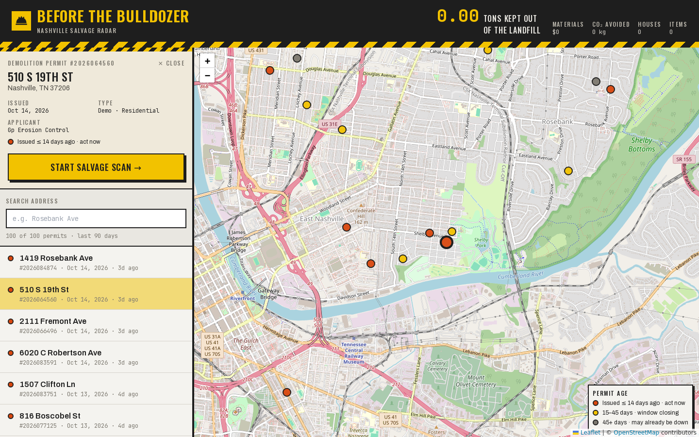
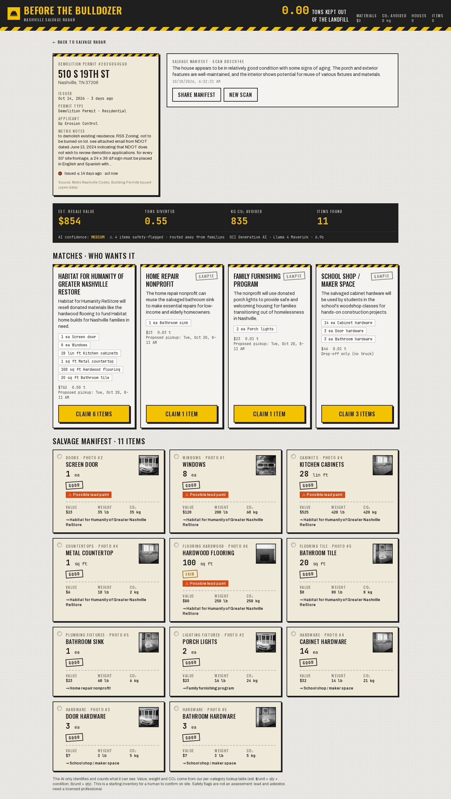
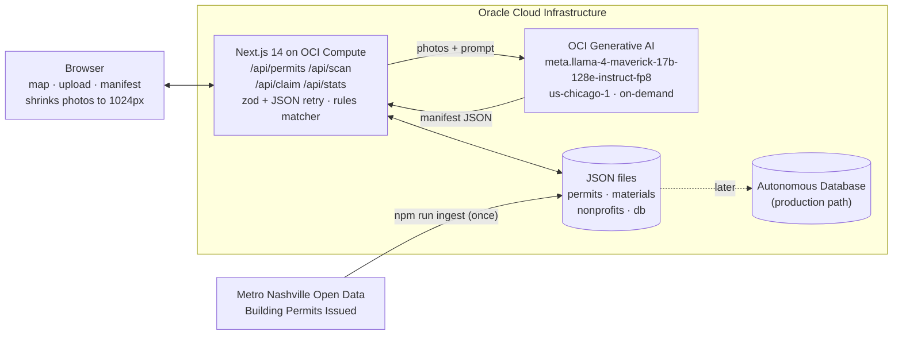

# Before the Bulldozer


**Every dot on this map is a Nashville house being torn down. We look inside before the bulldozer does.**

An AI salvage scout that inventories what's inside Nashville houses slated for demolition and routes reusable
doors, cabinets, flooring and fixtures to nonprofits before they hit the landfill.

HackTN26 · Team **West End Demons** · Challenge #1: From Surplus to Social Good

> **Cal Hacks update:** we started this project at HackTN26. At Cal Hacks we added an **Apify Actor**
> that keeps the permit feed fresh every day, and a team of **Fetch.ai agents** you can talk to on
> **ASI:One**: ask what's being torn down, pick a house, and the agents scan it, offer items to nonprofits,
> reroute what gets turned down, and book pickups, all inside the chat.
> See [What we built at Cal Hacks](#what-we-built-at-cal-hacks).

**Live demo:** https://beforethebulldozer.duckdns.org (Next.js on OCI Compute behind Caddy with HTTPS; direct: http://147.224.131.196:8000)



<details><summary>Salvage manifest and nonprofit matches</summary>


</details>

**Demo video (1:19):** [docs/demo.mp4](docs/demo.mp4), a captioned walkthrough recorded on the live site.

**Pitch deck:** [docs/deck/Before-the-Bulldozer-deck.pdf](docs/deck/Before-the-Bulldozer-deck.pdf) ([speaker notes and sources](docs/deck/README.md))

## The problem

<!-- TODO: replace homepage links with the exact article URLs from the build spec Sources section -->

- **Nashville landfills ~97% of its construction & demolition debris.** In 2021 the city produced 432,065 tons of C&D debris and recycled 13,928 tons (~3%). C&D is about a third of everything Nashville buries. ([Nashville Scene](https://www.nashvillescene.com/), [Metro Nashville](https://www.nashville.gov))
- **The burden lands on Bordeaux.** Until 2022 the Southern Services C&D landfill took 90% of that waste; it borders Bordeaux, a predominantly Black neighborhood whose residents have opposed it for two decades. Middle Point, Nashville's trash landfill, has 5–10 years left. ([Waste Advantage](https://wasteadvantagemag.com/))
- **Single-family teardowns fall through the cracks.** Metro's proposed C&D ordinance covers commercial projects and excludes single-family homes and townhomes of 4 units or fewer, which is exactly the teardown boom. Nobody inventories the house before it's demolished. ([WPLN](https://wpln.org/))

## How it works

1. **Salvage Radar** (`/`): a map of real residential demolition permits from Metro Nashville open data, colored by permit age.
2. **Property + scan** (`/property/[id]`): upload 3–8 room photos (resized to ≤1024 px in the browser). Llama 4 Maverick on OCI Generative AI returns a JSON salvage manifest.
3. **Manifest + matches**: item cards with condition and safety flags, totals (value, tons, CO₂), and nonprofit matches with a proposed pickup window. **Claim** marks items claimed and ticks the global "tons kept out of the landfill" counter.

## What we built at Cal Hacks

Before Cal Hacks, the permit list was pulled once by hand and every step after that needed a person
clicking through the app. Now it runs itself.

| New piece | Where | What it does |
| --- | --- | --- |
| **Apify Actor: Nashville Demolition Permits** | [`apify-actor/`](apify-actor/) | Queries Metro Nashville's open data for the newest residential demolition permits on a daily schedule and outputs them in the app's `Permit` format. |
| **Live permit sync** | `lib/apify.ts`, `POST /api/permits/sync` | The app reads the Actor's latest dataset and merges new permits in without a rebuild (permits are now read at request time). |
| **Fetch.ai agents on ASI:One** | [`agents/`](agents/) | A Concierge agent (Agent Chat Protocol, registered on Agentverse) runs the whole workflow from an ASI:One chat, backed by a Permit Watcher, Salvage Scout, Dispatcher, and one agent per nonprofit. Agent names and addresses are in [`agents/README.md`](agents/README.md). |
| **Rerouting** | `agents/btb_agents/dispatcher.py`, `lib/db.ts` | If a nonprofit passes on an item, the Dispatcher offers it to the next eligible nonprofit and the app records the new match. |

Everything else in this README (the map, the vision scan, the matching rules, the impact math) was
built at HackTN26.




The browser only talks to our API routes. The server holds the OCI credentials, calls the model, and reads and writes JSON files.

### How we use AI and OCI

| Piece | What it does |
| --- | --- |
| **OCI Generative AI: Llama 4 Maverick (vision)** | One multimodal call per scan: all photos + the appraiser prompt in, a JSON manifest out (item, category, qty, unit, condition, reusable, safety flags, photo index). |
| **OCI Generative AI: Llama 4 Maverick (text)** | One short call per match to write the human-readable reason ("why this nonprofit"). |
| **Rules engine** (`lib/match.ts`) | Decides *who gets what*: category overlap, reusable only, each item to exactly one nonprofit, **safety-flagged items never go to families**. |
| **Lookup table** (`data/materials.json`) | **The AI only identifies and counts.** Value, weight and CO₂ come from our per-category table, so every number is explainable: value = $/unit × qty × condition multiplier (excellent 1.0, good 0.75, fair 0.4, poor 0); weight = lb/unit × qty (reusable items only); CO₂ = weight × kg CO₂e/lb. |
| **Guardrails** (`lib/validate.ts`, `app/api/scan/route.ts`) | JSON extraction, retry once with "Return only valid JSON", zod validation (unknown categories dropped, quantities clamped, units normalized), 30 s budget, then fall back to the cached `data/demo-scan.json` (labeled "Cached demo scan" in the UI). |
| **OCI Compute** | E5.Flex VM, Oracle Linux 9, Node 20, pm2. |
| **OCI SDK auth** | `oci-generativeaiinference` + `oci-common` with `ConfigFileAuthenticationDetailsProvider` (API signing key in `~/.oci/config`). |

Measured latency on this VM: 1 photo ≈ 3–5 s, 6 photos ≈ 7–8 s end to end, including match reasons.

## Setup

Requirements: Node 20+, an OCI tenancy with Generative AI access in **us-chicago-1**, and an API signing key in `~/.oci/config`.

```bash
npm i
cp .env.example .env.local      # optional; defaults work with ~/.oci/config profile DEFAULT
npm run ingest                  # pull the latest demolition permits into data/permits.json
npm run dev                     # http://localhost:3000
```

### Apify Actor

```bash
npm i -g apify-cli
cd apify-actor && apify login && apify push
```

In Apify Console, run it once, then add a Schedule (e.g. daily at 7:00). In `.env.local` set
`APIFY_TOKEN` (Console > Settings > API & Integrations) and `APIFY_ACTOR_ID`
(`your-username~nashville-demolition-permits`). `npm run ingest` and `/api/permits/sync` then read from Apify.

### Fetch.ai agents

See [`agents/README.md`](agents/README.md). Short version:

```bash
cd agents && pip install -r requirements.txt
APP_URL=http://localhost:3000 SEED_PREFIX=your-secret python run_agents.py
```

Then connect the Concierge to Agentverse (Agent Inspector link in the log > Connect > Mailbox) and chat
with it on [ASI:One](https://asi1.ai). To test without ASI:One:
`WATCHER_ENABLED=false CONCIERGE_MAILBOX=false python test_chat.py`.

Environment variables (see `.env.example`):

| Var | Default |
| --- | --- |
| `OCI_REGION` | `us-chicago-1` |
| `OCI_MODEL_ID` | `meta.llama-4-maverick-17b-128e-instruct-fp8` (fallback: `meta.llama-4-scout-17b-16e-instruct`) |
| `OCI_COMPARTMENT_ID` | tenancy OCID from `~/.oci/config` |
| `OCI_CONFIG_PROFILE` | `DEFAULT` |
| `NEXT_PUBLIC_SHOW_CO2` | `true` (set `false` to hide CO₂ everywhere; rebuild required) |

### Deploy (OCI Compute)

```bash
npm ci && npm run build
pm2 start npm --name btb -- start -- -p 8000
pm2 save
# HTTPS on 80/443: Caddy reverse proxy (see /etc/caddy/Caddyfile)
#   <hostname> { reverse_proxy localhost:8000 }
# redeploy: git pull && npm run build && pm2 restart btb
```

## Data sources and honesty notes

| Data | Status |
| --- | --- |
| `data/permits.json` | **Real.** 100 most recent residential demolition permits (last 90 days) from Metro Nashville Codes' *Building Permits Issued* ArcGIS layer, via `scripts/ingest-permits.ts`. |
| `data/materials.json` | **Estimates.** Resale $/unit and weight from the team's starting table; to be checked against Habitat ReStore prices. CO₂ factors approximate EPA WARM source-reduction factors and must be verified before quoting. |
| `data/nonprofits.json` | Habitat for Humanity of Greater Nashville ReStore is a **real** organization (accepted categories to be confirmed). The other three are **samples**, labeled "Sample" in the UI. |
| Pickup window | A proposed slot (two business days out); real scheduling is out of scope. |
| Demo photos | **Public domain.** One 1920s bungalow documented by the Historic American Buildings Survey (HABS FL-538, Orlando, FL), standing in for a Nashville teardown (`public/demo/CREDITS.md`). |
| Photo estimates | A starting inventory for a human to confirm on site. Lead paint / asbestos flags are prompts to call a licensed professional, not an assessment. |

## API

| Method | Route | Body | Returns |
| --- | --- | --- | --- |
| GET | `/api/permits` | | `Permit[]` |
| POST | `/api/scan` | multipart: `permitId`, `photos` (≤8 jpg/png, ≤5 MB each) | `Scan` |
| GET | `/api/scan/[id]` | | `Scan` |
| POST | `/api/permits/sync` | header `x-agent-key` if `AGENT_API_KEY` is set | `{ fetched, added: Permit[], total }` |
| POST | `/api/claim` | `{ scanId, nonprofitId, itemIds, reroute? }` | `{ scan, stats }` |
| GET | `/api/stats` | | `Stats` |

## Team

**West End Demons**

- Mateen Bajlory ([@mateenbajlory](https://github.com/mateenbajlory))
- Omar Jebril ([@pepsi-boy](https://github.com/pepsi-boy))
- Sarmad Salman ([@sarmadd47](https://github.com/sarmadd47))
- Zahir Al Hinai ([@zalhinai006](https://github.com/zalhinai006))
- Ibrahim Boudaoud ([@ibrahimboudaoud](https://github.com/ibrahimboudaoud))
