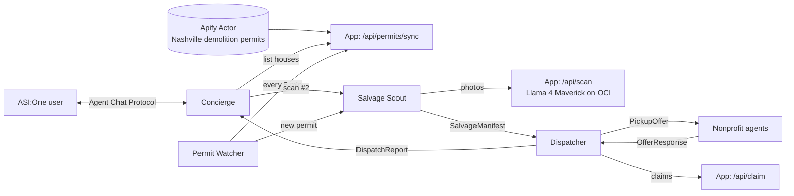

# Before the Bulldozer agents (Fetch.ai)


**Talk to it on ASI:One.** Ask what's being torn down in Nashville, pick a house, and a team of agents
inventories it, offers every reusable item to local nonprofits, reroutes what they pass on, and books
pickups. The whole workflow happens inside the ASI:One conversation.

## Agents

| Agent | Name | Address | What it does |
| --- | --- | --- | --- |
| **Concierge** (on Agentverse, ASI:One) | `before_the_bulldozer` | `PASTE_FROM_STARTUP_LOG` | Agent Chat Protocol front door. Understands the request (ASI:One LLM, with a rules fallback), pulls live permits, kicks off scans, and reports the salvage plan. |
| **Permit Watcher** | `permit_watcher` | `PASTE_FROM_STARTUP_LOG` | Syncs new permits from our Apify Actor on an interval and auto-scans new houses. |
| **Salvage Scout** | `salvage_scout` | `PASTE_FROM_STARTUP_LOG` | Sends house photos to the vision model (Llama 4 Maverick on Oracle Cloud) and builds the salvage manifest. |
| **Dispatcher** | `dispatcher` | `PASTE_FROM_STARTUP_LOG` | Offers items to nonprofit agents, reroutes declined items to the next eligible one, records pickups, reports back. |
| **Habitat ReStore** | `np_habitat_restore` | `PASTE_FROM_STARTUP_LOG` | Nonprofit agent: decides what it can accept. |
| **Home repair nonprofit** | `np_sample_home_repair` | `PASTE_FROM_STARTUP_LOG` | Nonprofit agent |
| **Family furnishing program** | `np_sample_family_furnishing` | `PASTE_FROM_STARTUP_LOG` | Nonprofit agent (never gets safety-flagged items) |
| **School shop / maker space** | `np_sample_maker_space` | `PASTE_FROM_STARTUP_LOG` | Nonprofit agent |

Addresses come from `SEED_PREFIX` and print when you run `python run_agents.py`.



## Example ASI:One conversation

This is real output from `test_chat.py` (fake permit feed, demo photos):

> **You:** what's being torn down in 37208?
>
> **Before the Bulldozer:** 4 houses in 37208 have residential demolition permits. Just pulled 2 new permits from the city. Newest:
> 1. **100 Test Ave, Nashville, TN 37208**, permit T2026000001, issued 2026-10-23
> 2. **1910 15th Ave N, Nashville, TN 37208**, permit 2026074011, issued 2026-09-30
> ...
>
> **You:** scan #1
>
> **Before the Bulldozer:** On it. Scanning **100 Test Ave**...
>
> **Before the Bulldozer:** **Salvage plan for 100 Test Ave** · Pickups booked for Tue Oct 27, 9am-12pm:
> - **Habitat for Humanity of Greater Nashville ReStore** is taking screen door, front door, kitchen cabinets, ...
> - **Home repair nonprofit** is taking sink
> - **Family furnishing program** is taking porch light fixtures
> - **Home repair nonprofit** is taking windows (rerouted after another nonprofit passed)
>
> Why some items moved: ReStore can't accept windows with a possible lead paint flag.
> Impact so far: 1 house scanned, 0.86 tons kept out of the landfill, about $1,023 in reusable materials.

## Run it

You need the Next.js app running (see the main README) with `APIFY_TOKEN` and `APIFY_ACTOR_ID` set.

```bash
cd agents
python -m venv .venv && source .venv/bin/activate
pip install -r requirements.txt

export APP_URL=http://localhost:3000        # or the deployed app URL
export SEED_PREFIX="pick-your-own-secret"   # stable, unique agent addresses
export ASI1_API_KEY=...                     # optional: ASI:One LLM reads user intent (rules fallback without it)
# export AGENT_API_KEY=...                  # only if you set one in the app's .env.local

python run_agents.py
```

### Register on Agentverse and use it from ASI:One

1. Run `python run_agents.py`. The Concierge starts with a mailbox.
2. Open the **Agent Inspector** link printed in the log for `before_the_bulldozer`, click **Connect**, choose **Mailbox**.
3. On [agentverse.ai](https://agentverse.ai), open the agent and check its profile (it uses `agents/CONCIERGE.md`).
4. On [asi1.ai](https://asi1.ai), ask "What's being torn down in Nashville?" or chat with the agent directly by its address.

Keep `run_agents.py` running (on the same OCI VM as the app works well) so the agent stays reachable.

### Test locally without ASI:One

```bash
WATCHER_ENABLED=false CONCIERGE_MAILBOX=false python test_chat.py
```

A fake ASI:One user asks for houses in 37208, scans #1, and asks for impact stats.

## Settings

| Env var | Default | |
| --- | --- | --- |
| `APP_URL` | `http://localhost:3000` | Where the Next.js app runs |
| `SEED_PREFIX` | placeholder | **Change this.** Agent addresses come from these seeds |
| `ASI1_API_KEY` | (empty) | ASI:One LLM for intent understanding |
| `ASI1_MODEL` | `asi1-mini` | |
| `AGENT_API_KEY` | (empty) | Sent as `x-agent-key`; must match the app |
| `POLL_SECONDS` | `300` | How often the Watcher syncs from Apify |
| `MAX_NEW_PER_SYNC` | `3` | New houses auto-scanned per tick (the rest queue) |
| `WATCHER_ENABLED` | `true` | Turn off autoscanning (chat still works) |
| `CONCIERGE_MAILBOX` | `true` | Connect the Concierge to Agentverse |
| `PHOTOS_DIR` | `agents/photos` | Real photos go in `agents/photos/<permit id>/` |
| `DEMO_MODE` | `true` | With no real photos, scan the public-domain demo house as a stand-in (the chat says so) |

## Honesty notes

- **Nonprofit policies are simulated.** For example, the ReStore agent passes on old windows flagged for
  possible lead paint. In production each nonprofit would run its own agent, or approve offers through one.
  Only Habitat ReStore is a real organization; the others are labeled samples.
- **Photos.** Until someone uploads site photos for a permit, the Scout scans the public-domain demo house and the
  chat says so.

## Extra resources

- Apify Actor: [`../apify-actor`](../apify-actor) (needs an Apify account; promo code `APIFY_CAL_HACKS` gives $200 credits)
- Oracle Cloud Generative AI for the vision scan (see main README). Without it, scans fall back to the cached demo scan.
